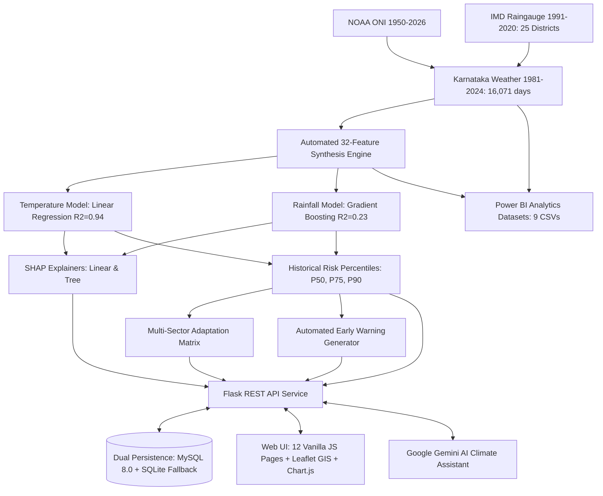

# AI-Driven El Niño-Aware Urban Heat Risk Prediction and Adaptation Planning System for Karnataka

[](https://www.python.org/)
[](https://flask.palletsprojects.com/)
[](https://scikit-learn.org/)
[](https://shap.readthedocs.io/)
[](https://leafletjs.com/)
[](https://www.mysql.com/)
[](https://powerbi.microsoft.com/)
[](#)

An end-to-end, full-stack climate intelligence and municipal risk adaptation planning platform engineered specifically for **Karnataka, India**. The system bridges macro-climatic ocean-atmosphere teleconnections—specifically the **NOAA Oceanic Niño Index (ONI)**—with 44 years of continuous daily weather records (1981–2024), dual machine learning forecasting models, SHAP explainability, compound hazard early warnings, an interactive Leaflet GIS spatial map, historical percentile risk classification, and multi-sector municipal adaptation planning.

**Project Root:** `C:\Users\vinod\Documents\KARNATAKA_CLIMATE_INTELLIGENCE`

---

## ⚡ Quick Start (One Startup Command)

Start the entire integrated application with a single command:

```powershell
cd C:\Users\vinod\Documents\KARNATAKA_CLIMATE_INTELLIGENCE
python run.py
```

Open your browser to: **http://127.0.0.1:5000**

To run on a custom port:
```powershell
python run.py --port 8080
```

---

## 🌟 Key System Capabilities

1. **Macro-Scale Climate Teleconnection Integration:**  
   Integrates the NOAA Oceanic Niño Index (3-month running mean sea surface temperature anomalies in the equatorial Pacific Niño 3.4 region) to evaluate El Niño, Neutral, and La Niña climate phases against Karnataka's local weather dynamics.
2. **Automated 32-Feature Engineering (Zero Manual Input Burden):**  
   Automatically synthesizes cyclical trigonometric calendar features (`Month_Sin/Cos`, `DayOfYear_Sin/Cos`), autoregressive lags (1, 2, 3, 7, 14, 30 days), rolling moving averages (7, 14, 30 days), and ENSO indicators. The user simply selects a date; all 32 technical features are synthesized and verified live.
3. **Dual Machine Learning Forecasting Pipelines:**  
   - **Temperature Model:** `StandardScaler` + `LinearRegression` ($R^2 \approx 0.94$, $\text{MAE} \approx 0.73^\circ\text{C}$).
   - **Rainfall Model:** `GradientBoostingRegressor` (150 estimators, lr=0.05, $R^2 \approx 0.23$, $\text{MAE} \approx 4.54\text{ mm}$).
4. **Explainable AI (SHAP):**  
   Deploys Linear and Tree SHAP explainers providing both global feature importance rankings and local waterfall/bar explanations computed live for every prediction.
5. **Interactive Karnataka GIS Spatial Map:**  
   A dedicated geospatial Leaflet visualization displaying 25 Karnataka districts with actual IMD manual raingauge station coordinates (1991–2020 record). Features dynamic layer switches for Drought Risk, Flood Risk, and Rainfall Volume, interactive station popups, and click-to-explore annual trend lines.
6. **Automated Early Warning & Compound Hazard System:**  
   Automatically evaluates multi-hazard risks (extreme heat waves, stormwater flooding, agricultural moisture deficits, and active ENSO phases) to generate color-coded early warning advisories (`CRITICAL ALERT`, `HIGH WATCH`, `ADVISORY`, `NORMAL`) with specific operational protocols for municipal and disaster management agencies.
7. **Statistically Grounded Historical Percentile Risk Tiers:**  
   Derived from 44 years of daily empirical observations (16,071 days, 1981–2024):
   - **Temperature:** Low ($\le 21.32^\circ\text{C}$), Moderate ($21.32–23.89^\circ\text{C}$), High ($23.89–24.83^\circ\text{C}$), Very High ($> 24.83^\circ\text{C}$).
   - **Rainfall:** Low ($\le 0.006\text{ mm}$), Normal ($0.006–7.35\text{ mm}$), High ($7.35–16.22\text{ mm}$), Very High ($> 16.22\text{ mm}$).
8. **Multi-Sector Municipal Adaptation Planning:**  
   Actionable protocols across 4 civic domains:
   - *Public Health & Labor Protection* (ORS kiosks, cooling centers, outdoor work shift limits)
   - *Urban Infrastructure & Cooling* (Cool roofs, misting corridors, tree canopy preservation)
   - *Stormwater Drainage & Flood Mitigation* (Drain de-silting, mobile dewatering pumps)
   - *Water Resources & Agriculture* (Rainwater harvesting retention, canal irrigation scheduling)
9. **Dual-Layer Database Persistence:**  
   MySQL 8.0 primary storage with automatic, seamless fallback to local SQLite (`predictions_local.sqlite`). The system guarantees prediction logging and history retrieval without requiring manual database setup.
10. **Grounded Gemini AI Climate Assistant:**  
    Grounded conversational assistant answering technical queries on Karnataka climate, model skill, and adaptation actions, backed by an offline domain engine when API credentials are absent.
11. **Microsoft Power BI Analytics Suite:**  
    9 curated CSV datasets, complete copy-paste DAX measures reference, and a 4-page dashboard implementation guide.

---

## 🏛️ System Architecture



---

## 📂 Project Directory Structure

```text
KARNATAKA_CLIMATE_INTELLIGENCE/
├── run.py                               # One-command server startup script
├── requirements.txt                     # Pinned Python package dependencies
├── .env.example                         # Environment configuration template
├── README.md                            # Comprehensive documentation
├── backend/
│   ├── app.py                           # Flask REST API server (12 pages, 14 APIs)
│   ├── database/
│   │   ├── db.py                        # Dual-layer database repository (MySQL + SQLite)
│   │   ├── schema.sql                   # MySQL DDL table schema
│   │   ├── init_db.py                   # Database table initialization & data loader
│   │   └── predictions_local.sqlite     # Local SQLite fallback database
│   └── services/
│       ├── climate_data.py              # In-memory cached dataset management
│       ├── risk.py                      # Risk tiers, early warning generator & adaptation matrix
│       ├── chatbot.py                   # Grounded Gemini API with offline domain engine
│       └── explain.py                   # SHAP LinearExplainer & TreeExplainer
├── frontend/
│   ├── templates/                       # 12 Responsive HTML5 templates
│   │   ├── index.html                   # 1. Executive Intelligence Dashboard
│   │   ├── climate.html                 # 2. Historical Climate & ENSO Analysis
│   │   ├── predict.html                 # 3. AI Predictions & Local SHAP Explainability
│   │   ├── explain.html                 # 4. Global SHAP Feature Importance
│   │   ├── adaptation.html              # 5. Multi-Sector Adaptation Action Matrix
│   │   ├── district.html                # 6. Karnataka District GIS Map & Rainfall Explorer
│   │   ├── risk.html                    # 7. Urban Heat Risk & Temperature Percentiles
│   │   ├── drought.html                 # 8. Drought Risk & Moisture Percentiles
│   │   ├── history.html                 # 9. Prediction History & Audit Logs
│   │   ├── chat.html                    # 10. Gemini Grounded Climate Assistant
│   │   ├── methodology.html             # 11. Scientific Methodology & Provenance
│   │   └── about.html                   # 12. System Architecture & Documentation
│   └── static/
│       ├── css/style.css                # Polished dark theme styling
│       └── js/                          # 14 Vanilla JS modules (Chart.js + Leaflet)
├── models/
│   ├── Temperature_Prediction_Model.pkl # Trained Linear Regression Pipeline
│   ├── Rainfall_Prediction_Model.pkl    # Trained Gradient Boosting Pipeline
│   └── Model_Feature_Columns.pkl        # List of 32 feature column names
├── datasets/
│   ├── raw/                             # Original NOAA ONI, IMD raingauges, weather CSVs
│   └── processed/                       # 16,071 daily cleaned records & feature engineered datasets
├── powerbi/                             # 9 CSV exports, DAX measures, & implementation guide
├── tests/
│   └── test_system.py                   # 44 automated unittests (100% PASS)
└── scratch/
    └── verify_all.py                    # 50 end-to-end live verification checks (100% PASS)
```

---

## 🌐 Complete Web Application Pages (12 Pages)

| Page | URL | Description |
|------|-----|-------------|
| **Executive Dashboard** | `/` | 44-year macro metrics, active early warning banner, yearly trend charts, ENSO distribution |
| **Climate & ENSO** | `/climate` | NOAA ONI timeline, temperature & rainfall anomalies across El Niño, Neutral, La Niña |
| **AI Predictions** | `/predict` | Dual ML model inference, 32-feature extraction, compound early warnings, local SHAP |
| **SHAP Explainability** | `/explain` | Global feature importance rankings, Linear and Tree SHAP evaluation metrics |
| **Adaptation Planning** | `/adaptation` | Multi-sector action matrix (Health, Urban, Drainage, Water/Agriculture) |
| **District GIS Explorer** | `/district` | **Leaflet GIS Map** with 25 IMD stations, risk-colored nodes, and annual trend analysis |
| **Urban Heat Risk** | `/risk` | Historical temperature percentiles (P50, P75, P90) and extreme heat days |
| **Drought Risk** | `/drought` | Trailing 30-day rainfall deficit percentiles and district drought indicators |
| **Prediction History** | `/history` | Auditable database log of predictions with CSV export functionality |
| **Climate Assistant** | `/chat` | Conversational chatbot powered by Google Gemini API with offline fallback |
| **Methodology** | `/methodology` | Scientific methodology, teleconnection physics, model limitations, and provenance |
| **About Project** | `/about` | Architectural design, dataset lineage, and academic citations |

---

## 🔌 REST API Endpoints Specification (14 Endpoints)

| Method | Endpoint | Description |
|--------|----------|-------------|
| `GET` | `/api` | Complete API directory listing, data ranges, and metadata |
| `GET` | `/api/health` | System health check, persistence mode, model loading status, record counts |
| `GET` | `/api/features` | Metadata for all 32 engineered technical features |
| `GET` | `/api/dashboard` | Aggregated 44-year climate trends, monthly climatology, and ENSO stats |
| `GET` | `/api/shap` | Global SHAP feature rankings for temperature and rainfall models |
| `GET` | `/api/district` | 25 Karnataka districts with IMD coordinates, rainfall, and risk tiers |
| `GET` | `/api/district/<name>` | Detailed station record, annual series, and linear rainfall trend for a district |
| `GET` | `/api/risk-thresholds` | Empirical temperature and rainfall percentile tiers (P50, P75, P90) |
| `GET` | `/api/drought-thresholds` | Trailing 30-day rainfall percentiles (P10, P25, P50) and drought metrics |
| `GET` | `/api/recommendations` | Sector-specific adaptation actions for any temperature/rainfall risk level |
| `GET` | `/api/methodology` | Dataset provenance, mathematical formulas, and scientific disclaimers |
| `GET` | `/api/alerts` | **Automated Early Warnings** for compound hazards on requested/latest date |
| `GET` | `/api/history` | Paginated prediction log from MySQL or local SQLite storage |
| `GET` | `/api/export-history-csv` | Download complete prediction history as CSV |
| `POST` | `/api/predict-from-date` | Execute dual ML inference by supplying a historical calendar date (`{"date": "YYYY-MM-DD"}`) |
| `POST` | `/api/predict` | Raw 32-feature vector inference |
| `POST` | `/api/chat` | Conversational query interface (`{"message": "..."}`) |

---

## 🗄️ Database Setup & Dual-Layer Persistence

The system automatically operates on **Local SQLite** out of the box with zero configuration required.

To connect your **MySQL 8.0** database:
1. Create a `backend/.env` file:
   ```env
   MYSQL_HOST=localhost
   MYSQL_PORT=3306
   MYSQL_USER=root
   MYSQL_PASSWORD=your_password_here
   MYSQL_DATABASE=elnino_karnataka_db
   ```
2. Initialize tables and populate historical records:
   ```powershell
   python backend/database/init_db.py
   ```
3. Restart `python run.py`. The system will automatically use MySQL as primary storage.

---

## 🧪 Verification & Test Results

Run the automated test suite:
```powershell
python -m unittest tests/test_system.py
```
**Result:** `44/44 Tests PASSED in 0.699s (100% OK)`

Run the live end-to-end verification script:
```powershell
python scratch/verify_all.py
```
**Result:** `50/50 Verification Checks PASSED (100% OK)`

---

## 📜 Scientific Grounding & Ethical Disclaimers

1. **ENSO Teleconnection Physics:** Oceanic Niño Index (ONI) represents large-scale equatorial Pacific sea surface temperature departures. While ENSO shifts regional atmospheric circulation, local Karnataka weather is governed by complex micro-scale interactions (Western Ghats orographic lift, Bay of Bengal cyclonic depressions, Arabian Sea moisture flux, and urban heat island effects). ENSO is treated as a background teleconnection signal, not the sole cause of daily weather events.
2. **Rainfall Model Skill:** Daily convective rainfall is notoriously non-linear ($R^2 \approx 0.23$). Model forecasts provide statistical directional guidance, not precise localized precipitation guarantees.
3. **Statistical Risk Tiers:** Risk categories (Low, Moderate/Normal, High, Very High) are exploratory percentile benchmarks derived from 44 years of empirical records (1981–2024). They serve as operational decision-support indicators, not official statutory disaster warnings issued by IMD or KSNDMC.
