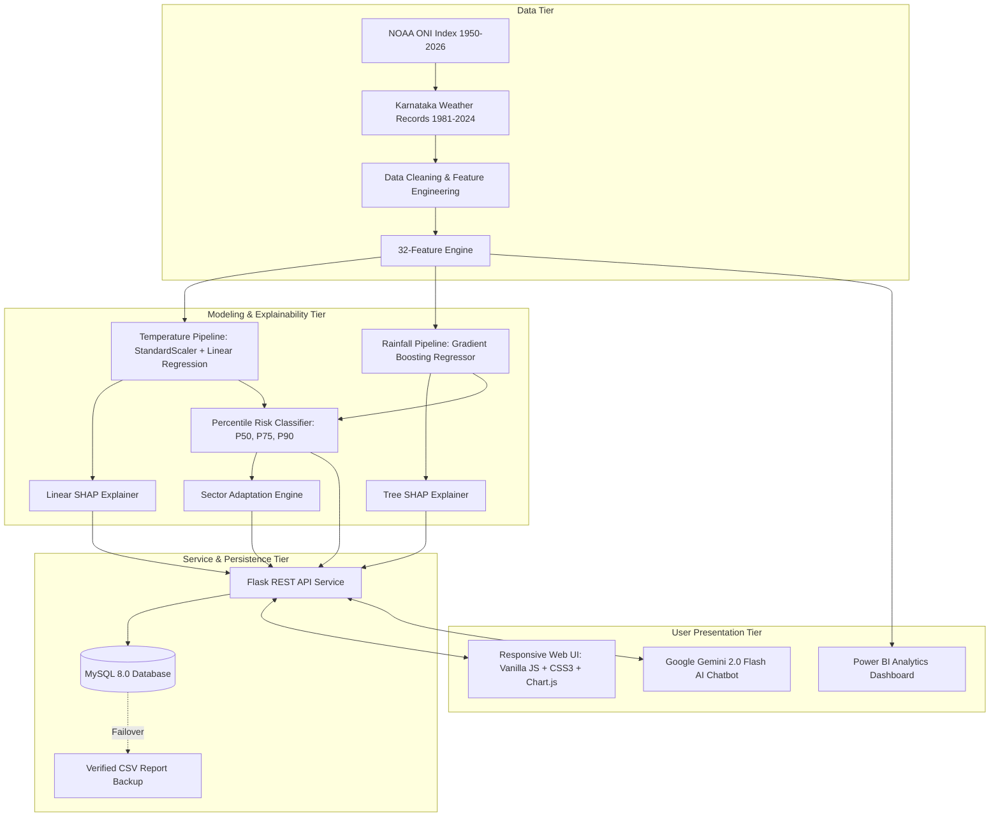
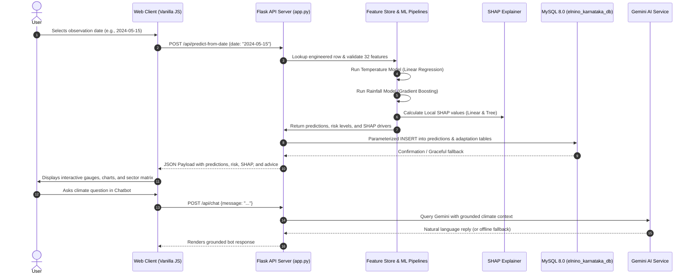

# Academic Project Report

## AI-Driven El Niño-Aware Urban Heat Risk Prediction and Adaptation Planning System for Karnataka

**Degree / Course:** Bachelor of Engineering / Technology (Computer Science & Engineering / Data Science / AI)  
**Project Type:** College Capstone / Mini-Project  
**Location:** Karnataka, India  
**Date:** November 2026  

---

## Abstract

Rapid urbanization combined with global climate variability has exacerbated microclimatic extremes across peninsular India, causing severe urban heat island (UHI) effects and erratic monsoon rainfall patterns. The El Niño-Southern Oscillation (ENSO), characterized by sea surface temperature (SST) anomalies in the equatorial Pacific, exerts an established teleconnection with the Indian Summer Monsoon and regional temperature trajectories. However, existing municipal disaster management frameworks often rely on coarse regional synoptic forecasts that fail to capture localized autoregressive trends or translate climate indices into actionable urban adaptation measures.

This project develops an end-to-end intelligent climate risk prediction and decision-support platform tailored for **Karnataka**. Integrating 44 years of continuous daily weather records (1981–2024) with the NOAA Oceanic Niño Index (ONI), the platform establishes an automated 32-dimensional feature engineering pipeline that incorporates cyclical calendar encodings, autoregressive lag terms, rolling window statistics, and ENSO state flags. Dual machine learning models—a scaled Linear Regression model for next-day mean temperature ($R^2 \approx 0.94$, $\text{MAE} \approx 0.73^\circ\text{C}$) and a Gradient Boosting Regressor for next-day rainfall ($R^2 \approx 0.23$, $\text{MAE} \approx 4.54\text{ mm}$)—are trained and evaluated. Model decision boundaries are demystified through both global and local SHAP (SHapley Additive exPlanations) explainability. Predictions are mapped to historical relative percentile risk categories (P50, P75, P90) to drive multi-sector municipal adaptation planning across Public Health, Urban Infrastructure, Stormwater Drainage, and Agriculture. The system is deployed via a modular Flask RESTful backend, a responsive Vanilla JavaScript dashboard, a grounded Google Gemini AI chatbot, persistent MySQL auditing, and Microsoft Power BI analytical reporting.

---

## 1. Problem Statement

Karnataka experiences pronounced climatic diversity, spanning the hyper-humid Western Ghats, the arid northern interior (Bayalu Seeme), and densely built urban centers such as Bengaluru. In recent years, urban centers have faced escalating heat waves, urban water stress, and sudden localized waterlogging. 

Key challenges addressed by this system:
1. **Disconnection Between Macro-Climatic Teleconnections and Local Forecasts:** While ENSO phases (El Niño and La Niña) shift broad weather patterns, local decision-makers lack accessible systems that combine macro ocean-atmosphere indices (NOAA ONI) with continuous historical weather dynamics.
2. **Absence of Actionable Municipal Sector Mapping:** Standard forecasts predict raw numerical meteorological variables ($^\circ\text{C}$ and $\text{mm}$) without translating them into concrete departmental interventions (e.g., cool roof coatings, ORS station deployment, stormwater desilting).
3. **Black-Box Nature of Machine Learning Models:** Complex predictive algorithms often lack transparency, preventing civic authorities from understanding the primary meteorological drivers behind elevated risk forecasts.
4. **Manual Feature Burden:** Existing ML demonstrators often force non-technical users to manually enter dozens of lag and rolling averages, creating operational friction.

---

## 2. Objectives

The core objectives of the system are:
- **Historical Data Integration:** Synthesize 44 years (1981–2024) of cleaned daily Karnataka meteorological records with the NOAA Oceanic Niño Index (1950–2026).
- **Automated Feature Generation:** Dynamically construct 32 engineered features from historical time-series data without requiring manual user parameter entry.
- **Dual Predictive Modeling:** Deploy dedicated machine learning pipelines to forecast next-day mean temperature and next-day rainfall.
- **Explainable AI Integration:** Implement Linear and Tree SHAP explainers to attribute exact additive contributions of each feature to predictions.
- **Percentile-Based Relative Risk Classification:** Derive statistical risk thresholds (Low, Moderate/Normal, High, Very High) from historical percentiles rather than arbitrary thresholds.
- **Multi-Sector Adaptation Planning:** Formulate structured operational directives for Public Health, Urban Infrastructure, Stormwater Drainage, and Water/Agriculture.
- **Full-Stack Enterprise Deployment:** Provide a responsive Vanilla JS dashboard, Flask backend, MySQL audit logging, grounded Gemini AI assistant, and Power BI dashboards.

---

## 3. Literature Review Structure

1. **ENSO Teleconnections and Peninsular Indian Weather:**  
   *Walker (1924)* and *Sikka (1980)* established the negative correlation between tropical Pacific sea surface warmings (El Niño) and Indian monsoon precipitation. Subsequent studies (*Ropelewski & Halpert, 1987; Gadgil et al., 2004*) demonstrated that while El Niño events often predispose the subcontinent to monsoon droughts and elevated summer temperatures, approximately one-third of El Niño years produce near-normal rainfall due to mitigating Indian Ocean Dipole (IOD) interactions and regional monsoon depressions.
2. **Urban Heat Island Dynamics in Tropical Megacities:**  
   Studies on Bengaluru and Mysore (*Ramachandra et al., 2017*) document significant land surface temperature rises attributable to the rapid conversion of green vegetative cover into impervious concrete surfaces. The thermal inertia of dense built fabric necessitates localized autoregressive modeling.
3. **Machine Learning in Short-Term Weather Forecasting:**  
   Autoregressive modeling techniques (e.g., ARIMA, Random Forests, Gradient Boosted Decision Trees) have demonstrated high accuracy in temperature forecasting (*Rasp et al., 2020*). Conversely, daily precipitation forecasting remains an open challenge characterized by zero-inflation, extreme skewed distributions, and localized convective instability.
4. **Explainable AI (XAI) in Environmental Sciences:**  
   *Lundberg and Lee (2017)* introduced SHAP (SHapley Additive exPlanations) based on cooperative game theory, establishing a mathematically sound framework to attribute complex non-linear model predictions to individual input variables.

---

## 4. System Architecture

The system is architected as a modular, decoupled tier system:

---

## 5. Data Flow Diagram (DFD)

---

## 6. Methodology & Data Pipeline

### 6.1 Data Acquisition and Cleaning
1. **Precipitation & Temperature Series:** Historical meteorological series (1981–2024) comprising 16,071 daily observations. Variables include Daily Mean, Maximum, and Minimum Temperatures ($^\circ\text{C}$) and Rainfall ($\text{mm}$). Missing entries were checked, verified for physical bounds ($\text{Min\_Temp} \le \text{Mean\_Temp} \le \text{Max\_Temp}$), and imputed with chronological continuity.
2. **Oceanic Niño Index (ONI):** NOAA Climate Prediction Center 3-month running mean SST departures in the Niño 3.4 region ($5^\circ\text{N}–5^\circ\text{S}, 170^\circ\text{W}–120^\circ\text{W}$). Forward-filled across corresponding daily observations without temporal leakage.

### 6.2 Feature Engineering (32 Dimensions)
To capture temporal periodicity, thermal memory, and macro-climatic state without data leakage:
- **Trigonometric Cyclical Encodings:**
  $$\text{Month\_Sin} = \sin\left(\frac{2\pi \cdot \text{Month}}{12}\right), \quad \text{Month\_Cos} = \cos\left(\frac{2\pi \cdot \text{Month}}{12}\right)$$
  $$\text{DayOfYear\_Sin} = \sin\left(\frac{2\pi \cdot \text{DOY}}{365.25}\right), \quad \text{DayOfYear\_Cos} = \cos\left(\frac{2\pi \cdot \text{DOY}}{365.25}\right)$$
- **Autoregressive Lags:** Lagged temperature and precipitation observations at $t-1, t-2, t-3, t-7, t-14, t-30$ days.
- **Moving Window Averages:** Rolling 7-day, 14-day, and 30-day backward-looking statistics.
- **Macro Climate Flags:** Current $\text{ONI}$, lagged $\text{ONI}_{t-30}$, and one-hot encoded flags for $\text{El\_Niño}$ ($\text{ONI} \ge +0.5$), $\text{La\_Niña}$ ($\text{ONI} \le -0.5$), and $\text{Neutral}$ ($-0.5 < \text{ONI} < +0.5$).

### 6.3 Historical Risk Percentile Thresholds (Step 13)
Rather than arbitrary static limits, thresholds are statistically derived from the 44-year Karnataka distribution:

| Variable | Percentile Metric | Statistical Value | Risk Level Assigned |
| :--- | :--- | :--- | :--- |
| **Temperature** | $\le P_{50}$ | $\le 21.32^\circ\text{C}$ | **Low Heat Risk** |
| | $P_{50} < T \le P_{75}$ | $21.32^\circ\text{C} - 23.89^\circ\text{C}$ | **Moderate Heat Risk** |
| | $P_{75} < T \le P_{90}$ | $23.89^\circ\text{C} - 24.83^\circ\text{C}$ | **High Heat Risk** |
| | $> P_{90}$ | $> 24.83^\circ\text{C}$ | **Very High Heat Risk** |
| **Rainfall** | $\le P_{25}$ | $\le 0.006\text{ mm}$ | **Low Rainfall / Dry** |
| | $P_{25} < R \le P_{75}$ | $0.006\text{ mm} - 7.35\text{ mm}$ | **Normal Rainfall** |
| | $P_{75} < R \le P_{90}$ | $7.35\text{ mm} - 16.22\text{ mm}$ | **High Rainfall Risk** |
| | $> P_{90}$ | $> 16.22\text{ mm}$ | **Very High Rainfall Risk** |

---

## 7. Machine Learning Algorithms & Mathematical Foundations

### 7.1 Temperature Model: StandardScaler + Linear Regression
Given input vector $\mathbf{x} \in \mathbb{R}^{32}$, features are normalized to zero mean and unit variance:
$$\tilde{x}_j = \frac{x_j - \mu_j}{\sigma_j}$$
The prediction is computed via ordinary least squares:
$$\hat{y}_{\text{temp}} = w_0 + \sum_{j=1}^{32} w_j \tilde{x}_j$$

### 7.2 Rainfall Model: Gradient Tree Boosting Regressor
The rainfall model constructs an ensemble of $M = 150$ regression trees with learning rate $\eta = 0.05$:
$$\hat{y}_{\text{rain}}^{(m)} = \hat{y}_{\text{rain}}^{(m-1)} + \eta \sum_{j=1}^{J} \gamma_{jm} I(\mathbf{x} \in R_{jm})$$
Predictions are constrained non-negative: $\hat{y}_{\text{rain}} = \max(\hat{y}, 0)$.

### 7.3 SHAP (SHapley Additive exPlanations)
For model prediction $f(\mathbf{x})$, SHAP decomposes the output into additive feature attributions:
$$f(\mathbf{x}) = \phi_0 + \sum_{j=1}^{M} \phi_j$$
where base value $\phi_0 = \mathbb{E}[f(\mathbf{x})]$ and $\phi_j$ represents the marginal contribution of feature $j$ across all possible feature subsets $S \subseteq F \setminus \{j\}$.

---

## 8. Database Schema (`elnino_karnataka_db`)

The relational MySQL schema comprises three structured tables:
1. `weather_climate_data`: 16,071 historical rows storing daily observations, ONI values, and condition categories.
2. `predictions`: Audited model outputs, predicted temperature, predicted rainfall, risk categories, and ONI values.
3. `adaptation_recommendations`: Action directives categorized by recommendation type (Temperature/Rainfall), risk level, and date.

---

## 9. Experimental Results & Evaluation

The models were evaluated on an independent hold-out test set (Step 10):

| Model | Target Variable | Mean Absolute Error (MAE) | Root Mean Squared Error (RMSE) | $R^2$ Score | Mean Residual Error | Residual Std Dev |
| :--- | :--- | :--- | :--- | :--- | :--- | :--- |
| **Linear Regression** | Next-Day Mean Temp | **0.7252 °C** | **0.9263 °C** | **0.9398** | -0.0215 | 0.9260 |
| **Gradient Boosting** | Next-Day Rainfall | **4.5415 mm** | **7.3401 mm** | **0.2320** | -0.3608 | 7.3312 |

### Global SHAP Importance Findings
- **Temperature:** Dominated by seasonal cyclical encodings (`DayOfYear_Cos`, `DayOfYear_Sin`), immediate autoregressive persistence (`Temperature_Lag_1`), and weekly trend (`Temperature_Rolling_7`).
- **Rainfall:** Dominated by multi-day rolling moisture (`Rainfall_Rolling_7`, `Rainfall_Rolling_14`) and seasonal monsoonal windows. ONI acts as a baseline background modulator rather than a dominant immediate driver.

---

## 10. Discussion & Scientific Realism

A central contribution of this project is its adherence to scientific realism:
1. **Correlation vs. Causation:** The system explicitly refrains from claiming that El Niño directly causes every individual hot day or drought spell in Karnataka. ENSO is modeled as a probabilistic macro boundary condition operating alongside regional dynamics (Western Ghats, monsoonal depressions, Arabian Sea cyclogenesis).
2. **Rainfall Modeling Realism:** Rather than misrepresenting the modest rainfall $R^2$ (0.2320), the system openly documents this limitation and uses rainfall predictions primarily to classify relative risk percentiles.
3. **Statutory Alert Distinction:** The project's relative risk percentiles are educational and decision-support benchmarks, maintaining clear disclaimers that statutory emergency warnings remain the exclusive domain of IMD and KSNDMC.

---

## 11. Limitations & Future Enhancements

### Limitations
- **Spatial Resolution:** The current dataset aggregates state-wide or regional averages; microclimatic intra-district variations (e.g., coastal Karwar vs. arid Kalaburagi) are not modeled separately.
- **Atmospheric Variables:** Relative humidity, wind speed, solar irradiance, and Wet Bulb Globe Temperature (WBGT) were not present in the historical base dataset.

### Future Enhancements
- **Spatial District Gridding:** Integrate district-level weather stations across all 31 Karnataka districts.
- **Deep Learning Sequence Models:** Explore Temporal Fusion Transformers (TFT) and Bi-LSTM architectures.
- **Live IoT / KSNDMC API Telemetry:** Ingest real-time telemetric weather station feeds.

---

## 12. Conclusion

This project successfully implements a comprehensive, AI-driven climate risk intelligence and adaptation planning system for Karnataka. By integrating 44 years of daily meteorological data with NOAA ONI indices, the platform automates 32-feature extraction, executes dual machine learning inference, provides SHAP explainability, maps statistical risk percentiles to multi-sector municipal adaptation directives, and delivers a modern, full-stack decision-support experience.

---

## 13. References

1. Walker, G. T. (1924). *Correlation in seasonal variations of weather, IX.* Memoirs of the India Meteorological Department.
2. Sikka, D. R. (1980). *Some aspects of the large-scale fluctuations of summer monsoon rainfall over India in relation to fluctuations in the planetary and regional scale circulation parameters.* Proceedings of the Indian Academy of Sciences.
3. Gadgil, S., Vinayachandran, P. N., Francis, P. A., & Gadgil, S. (2004). *Extremes of the Indian summer monsoon rainfall, ENSO and equatorial Indian Ocean oscillation.* Geophysical Research Letters.
4. Lundberg, S. M., & Lee, S. I. (2017). *A unified approach to interpreting model predictions.* Advances in Neural Information Processing Systems (NeurIPS).
5. Ramachandra, T. V., Bharath, A. H., & Sowmyashree, M. V. (2017). *Urban footprint growing: Spatio-temporal analysis of Bangalore.* Journal of Environmental Management.
6. India Meteorological Department (IMD). *Climate Diagnostics and Monsoonal Trends Reports.* Ministry of Earth Sciences, Govt. of India.
